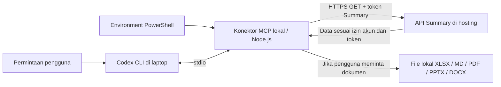

# Setup MCP Summary di Windows PowerShell

Panduan ini menggunakan proyek `C:\laragon\www\summary`, domain contoh `https://summary.timurbersinar.com`, dan PowerShell Windows. Sesuaikan folder/domain jika berbeda. Jalankan kode bertanda `powershell` pada terminal `PS C:\...>`, bukan dalam percakapan Codex atau terminal WSL.

## Daftar isi

1. [Cara kerja dan persiapan](#1-cara-kerja-dan-persiapan)
2. [Bangun konektor sekali](#2-bangun-konektor-sekali)
3. [Daftarkan MCP sekali](#3-daftarkan-mcp-sekali)
4. [Isi URL, token, dan folder dokumen](#4-isi-url-token-dan-folder-dokumen)
5. [Uji koneksi sebelum membuka Codex](#5-uji-koneksi-sebelum-membuka-codex)
6. [Simpan pengaturan untuk terminal berikutnya](#6-simpan-pengaturan-untuk-terminal-berikutnya)
7. [Penggunaan harian dan dokumen](#7-penggunaan-harian-dan-dokumen)
8. [Ganti token](#8-ganti-token)
9. [Ganti alamat web atau folder keluaran](#9-ganti-alamat-web-atau-folder-keluaran)
10. [Pembaruan, penghapusan kredensial, dan error](#10-pembaruan-penghapusan-kredensial-dan-error)

## 1. Cara kerja dan persiapan



API menyediakan pembacaan data Summary. Pembuatan dokumen menulis file di laptop, tanpa menambah, mengubah, atau menghapus data Summary. Isi laporan yang dibaca dapat menjadi konteks pada layanan AI yang digunakan.

Siapkan:

- Node.js minimal 22.13, npm, serta Codex CLI yang sudah terpasang pada Windows.
- Login Codex memakai akun ChatGPT yang memiliki akses Codex. Konektor tidak memerlukan API key model atau pembelian kredit API. Batas pemakaian mengikuti akun/paket.
- Summary menggunakan HTTPS dengan sertifikat sah dan API AI sudah aktif. Aktivasi hosting dijelaskan dalam [panduan deployment](AI_DEPLOYMENT.md).
- Akun Summary mempunyai permission `use_ai_api` dan izin baca data yang diperlukan.

Periksa perangkat di PowerShell:

```powershell
Get-Command node, npm, codex | Select-Object Name, CommandType, Source
node --version
node -p "process.platform"
codex --version
codex login status
```

Platform harus `win32`. Jika belum login, jalankan `codex login`, lalu pilih login ChatGPT. Jangan memasukkan token Summary pada proses login Codex: kedua kredensial mempunyai tujuan berbeda.

Di web Summary, buka **Akses AI** dan buat token untuk laptop. Pilih dataset, kolom, relasi, masa berlaku, serta cakupan laporan yang diperlukan. Untuk pengelompokan IKU, izinkan dataset IKU/`indicators` beserta ID/nama dan kolom laporan terkait. Kolom lain dapat dibaca sesuai permintaan pengguna dan izin token. Token tidak memperluas izin akun. Salin token lengkap saat ditampilkan; masukkan nanti pada langkah 4.

## 2. Bangun konektor sekali

```powershell
Set-Location 'C:\laragon\www\summary\tools\summary-assistant'
npm prefix
npm pkg get name scripts.build scripts.test
npm ci
npm run build
npm test
```

Hasil yang benar:

- `npm prefix` berakhir dengan `tools\summary-assistant`.
- Nama paket `summary-assistant`; build menjalankan `tsc`.
- Ada file `dist\index.js` dan `dist\client.js`.

```powershell
Test-Path '.\dist\index.js'
Test-Path '.\dist\client.js'
```

Keduanya harus `True`. Pertahankan folder `assets` bersama paket karena PDF menggunakan font lokal. `npm ci` menginstal ulang dependency pada paket aktif; jalankan hanya ketika diperlukan, bukan setiap membuka Codex.

Jika build menampilkan `vite build` atau test menghasilkan `Missing script: "test"`, kamu berada di paket frontend induk. Ulangi dari `Set-Location` di atas. Folder `tools` saja bukan folder konektor.

## 3. Daftarkan MCP sekali

Konfigurasi default Codex Windows ada di `$HOME\.codex\config.toml`, misalnya `C:\Users\nama-anda\.codex\config.toml`. Jika sengaja memakai `CODEX_HOME`, gunakan `config.toml` dalam direktori tersebut.

```powershell
New-Item -ItemType Directory -Force (Join-Path $HOME '.codex') | Out-Null
notepad (Join-Path $HOME '.codex\config.toml')
```

Tambahkan blok ini. Jika sudah ada `[mcp_servers.summary]`, perbarui blok yang ada; jangan membuat duplikat atau menimpa pengaturan lain.

```toml
[mcp_servers.summary]
command = "node"
args = ["C:/laragon/www/summary/tools/summary-assistant/dist/index.js"]
env_vars = ["SUMMARY_BASE_URL", "SUMMARY_API_TOKEN", "SUMMARY_OUTPUT_DIR"]
tool_timeout_sec = 180
```

Gunakan garis miring `/` pada path di TOML. Bila Node tidak ditemukan saat MCP berjalan, ganti `command` dengan path absolut hasil `Get-Command node`, misalnya `C:/Program Files/nodejs/node.exe`.

`env_vars` hanya menyebut nama variabel yang diteruskan ke konektor; daftar tersebut tidak mengisi nilainya. Nilai diisi pada langkah berikutnya. Jika ada nilai lama pada `[mcp_servers.summary.env]` untuk variabel yang sama, hapus entri lama tersebut agar memakai satu sumber pengaturan. Periksa juga `.codex/config.toml` proyek jika ada konfigurasi lokal yang berbeda.

Konektor ini merupakan MCP **stdio lokal**. Domain web Summary adalah alamat REST API yang diakses konektor; jangan mendaftarkan domain tersebut sebagai server MCP HTTP.

## 4. Isi URL, token, dan folder dokumen

Jalankan di PowerShell yang nantinya dipakai membuka Codex:

```powershell
$env:SUMMARY_BASE_URL = 'https://summary.timurbersinar.com'
$env:SUMMARY_API_TOKEN = [System.Net.NetworkCredential]::new('', (Read-Host 'Tempel token Summary lalu Enter' -AsSecureString)).Password.Trim()
$env:SUMMARY_OUTPUT_DIR = Join-Path $HOME 'Summary-outputs'
```

Pada prompt token, tempel token lengkap dari web Summary, lalu Enter. Input disembunyikan. Jangan menambahkan kata `Bearer`, tanda kutip, atau baris baru. Jangan mengirim token ke AI atau menyimpannya dalam repository.

URL adalah alamat dasar aplikasi, tanpa `/api/ai/v1`, tanpa query, dan tanpa fragment. Jika aplikasi berada pada subfolder, sertakan subfolder itu, misalnya `https://contoh.id/summary`. Gunakan domain akhir yang tidak melakukan redirect.

Konektor membaca environment proses ketika dimulai. Membuat file `.env` di folder konektor tidak otomatis mengisi environment. `.env` Laravel di hosting mengatur server, bukan token laptop.

## 5. Uji koneksi sebelum membuka Codex

Periksa nilai yang diterima Node tanpa menampilkan token:

```powershell
node -e "console.log(JSON.stringify({url:process.env.SUMMARY_BASE_URL ?? null,tokenTerisi:Boolean(process.env.SUMMARY_API_TOKEN)}))"
```

Contoh hasil:

```json
{"url":"https://summary.timurbersinar.com","tokenTerisi":true}
```

Lalu uji client yang sama dengan konektor. Jalankan seluruh perintah `node` berikut sebagai satu baris:

```powershell
Set-Location 'C:\laragon\www\summary\tools\summary-assistant'
node --input-type=module -e "import { SummaryClient } from './dist/client.js'; try { const c = new SummaryClient(process.env.SUMMARY_BASE_URL, process.env.SUMMARY_API_TOKEN); await c.read('capabilities'); await c.read('schema'); console.log('CLIENT_OK'); } catch (e) { console.log('CLIENT_ERROR:', e.message); process.exitCode = 1; }"
```

`CLIENT_OK` berarti URL/token diterima dan endpoint capabilities serta schema dapat dibaca oleh proses Node tersebut. Ini belum membuktikan semua dataset atau kolom diizinkan; cakupan efektif mengikuti isi capabilities/schema.

Jika belum `CLIENT_OK`, selesaikan error pada langkah 10 dahulu. Jika berhasil, environment saat ini siap diteruskan ke Codex.

## 6. Simpan pengaturan untuk terminal berikutnya

Tanpa langkah ini, `$env:...` hilang setelah jendela terminal ditutup. Pilih sesuai kebutuhan:

- **Sementara:** ulangi langkah 4 saat membuka terminal baru; token tidak disimpan permanen oleh panduan ini.
- **Tetap pada akun Windows pribadi:** jalankan perintah berikut setelah langkah 5 berhasil.

```powershell
[Environment]::SetEnvironmentVariable('SUMMARY_BASE_URL', $env:SUMMARY_BASE_URL, 'User')
[Environment]::SetEnvironmentVariable('SUMMARY_API_TOKEN', $env:SUMMARY_API_TOKEN, 'User')
[Environment]::SetEnvironmentVariable('SUMMARY_OUTPUT_DIR', $env:SUMMARY_OUTPUT_DIR, 'User')
```

Penyimpanan User menyimpan token sebagai teks biasa dalam environment akun Windows, bukan brankas terenkripsi. Gunakan akun pribadi yang tepercaya. Kode di atas menyimpan nilai yang sudah ada tanpa menampilkannya.

Pengaturan User tidak memperbarui proses yang sudah berjalan. Tutup seluruh jendela Windows Terminal/PowerShell, lalu buka ulang dari menu Start. Jika menggunakan terminal VS Code atau aplikasi lain, mulai ulang aplikasi induknya juga. Periksa kembali langkah 5 pada terminal baru. Jika environment masih lama, keluar lalu masuk kembali akun Windows.

## 7. Penggunaan harian dan dokumen

Jika pengaturan sudah tersimpan, cukup buka PowerShell baru lalu:

```powershell
Set-Location 'C:\laragon\www\summary\tools\summary-assistant'
codex mcp list
codex
```

Di dalam Codex, `/mcp` menunjukkan konektor aktif. Mintalah:

> Periksa summary_capabilities dan summary_schema terlebih dahulu. Kelompokkan seluruh kegiatan berdasarkan Indikator Kinerja resmi pada triwulan III 2026, periode 1 Juli–30 September 2026. Gunakan data sesuai izin, jelaskan definisi periode dan keterbatasannya. Buat Excel berisi data serta rekap, dan DOCX berisi ringkasan dengan sumber ID laporan. Jangan mengubah data Summary.

Format lain dapat diminta: Markdown (`.md`), PDF (`.pdf`), PowerPoint (`.pptx`), Word (`.docx`), atau Excel (`.xlsx`). Tanpa permintaan dokumen, hasil disajikan di percakapan terminal. Pengelompokan dapat memakai kolom lain yang tersedia, bukan hanya what, IKU, when, atau how.

Folder default dokumen adalah `$HOME\Summary-outputs`; tool mengembalikan path file yang dibuat. Buka folder:

```powershell
explorer.exe $env:SUMMARY_OUTPUT_DIR
```

Tidak perlu menjalankan `npm start` terpisah: Codex memulai konektor. Proses yang dimulai ulang kehilangan dataset sementara di memori; minta pengambilan ulang bila diperlukan. Rekap, sumber, dan penanda data parsial dijelaskan di [panduan analisis](AI_CODEX_SETUP.md#membaca-hasil).

## 8. Ganti token

1. Keluar dari Codex sampai kembali ke prompt PowerShell.
2. Di web Summary, buat token pengganti dengan dataset/kolom/cakupan yang diperlukan.
3. Isi token baru pada PowerShell:

```powershell
$env:SUMMARY_API_TOKEN = [System.Net.NetworkCredential]::new('', (Read-Host 'Tempel token Summary BARU lalu Enter' -AsSecureString)).Password.Trim()
```

4. Ulangi uji pada langkah 5. Jika `CLIENT_OK` dan kamu menggunakan penyimpanan tetap, perbarui nilai tersimpan:

```powershell
[Environment]::SetEnvironmentVariable('SUMMARY_API_TOKEN', $env:SUMMARY_API_TOKEN, 'User')
```

5. Cabut token lama melalui halaman Akses AI setelah pengganti berhasil. Jika token lama bocor, cabut segera.
6. Buka kembali `codex` dari PowerShell yang sudah diuji. Terminal/aplikasi lain yang masih berjalan perlu dibuka ulang untuk menerima nilai tersimpan yang baru.

Tidak perlu `npm ci`, build, atau mengubah TOML ketika hanya mengganti token. Pencabutan token tidak menghapus dokumen yang sudah tersimpan di laptop.

## 9. Ganti alamat web atau folder keluaran

Keluar dari Codex, kemudian isi alamat baru yang benar-benar kamu gunakan:

```powershell
$env:SUMMARY_BASE_URL = 'https://alamat-summary-baru.example'
```

Alamat `.example` di atas adalah placeholder; ganti dengan domain nyata. Pastikan API aktif pada tujuan. Token harus sah pada instalasi Summary tujuan; jika pindah instalasi, buat token di web tujuan dan ikuti langkah 8. Konektor mengirim token ke URL yang kamu tentukan, jadi pastikan alamatnya benar sebelum pengujian.

Jalankan uji langkah 5. Jika berhasil dan memakai penyimpanan tetap:

```powershell
[Environment]::SetEnvironmentVariable('SUMMARY_BASE_URL', $env:SUMMARY_BASE_URL, 'User')
```

Untuk mengganti folder dokumen:

```powershell
$env:SUMMARY_OUTPUT_DIR = 'C:\Users\nama-anda\Documents\Summary-outputs'
[Environment]::SetEnvironmentVariable('SUMMARY_OUTPUT_DIR', $env:SUMMARY_OUTPUT_DIR, 'User')
```

Sesuaikan nama akun/folder. Gunakan folder lokal yang bisa ditulis dan bukan symlink. Mulai ulang Codex sesudah perubahan. Dokumen lama tetap berada di folder lama. TOML hanya perlu diperbarui bila lokasi `dist/index.js` atau executable Node berubah.

## 10. Pembaruan, penghapusan kredensial, dan error

### Kapan menjalankan npm lagi?

| Kejadian | Yang dilakukan |
|---|---|
| Pertama setup | `npm ci`, `npm run build`, `npm test` di paket konektor |
| Menggunakan harian | Buka Codex dari terminal dengan environment yang benar |
| Ganti token/domain/folder keluaran | Perbarui environment, uji, restart Codex |
| Source konektor berubah setelah pembaruan Git | `npm run build`, `npm test`, restart Codex |
| Dependency/lockfile berubah atau node_modules hilang | `npm ci`, `npm run build`, `npm test`, restart Codex |
| Folder proyek dipindahkan | Perbarui path MCP di TOML dan periksa `dist/index.js` |

### Menghapus kredensial dari laptop

Keluar dari Codex, hapus nilai tersimpan serta nilai sesi:

```powershell
[Environment]::SetEnvironmentVariable('SUMMARY_API_TOKEN', $null, 'User')
Remove-Item Env:SUMMARY_API_TOKEN -ErrorAction SilentlyContinue
```

Mulai ulang terminal/aplikasi lain yang mungkin masih memegang token. Untuk mencabut akses API sepenuhnya, cabut token di web Summary; menghapus environment laptop saja tidak mencabut token pada server.

### Tabel penanganan error

| Hasil/error | Pemeriksaan dan tindakan |
|---|---|
| `tokenTerisi:false` | Token tidak ada pada proses Node saat ini. Ulangi langkah 4 pada PowerShell yang sama, lalu uji. Daftar `env_vars` saja tidak mengisi token. |
| `Invalid URL` atau URL `null` | Isi `SUMMARY_BASE_URL` dengan URL HTTPS lengkap pada terminal yang sama. |
| `CLIENT_ERROR: Summary HTTP 401` | Pastikan token lengkap dari web tujuan, masih aktif, dan belum kedaluwarsa. Ulangi pengisian token lalu uji; baru buat pengganti jika diperlukan. |
| `CLIENT_OK`, tetapi MCP Codex masih 401 | Keluar dari Codex lalu mulai kembali dari terminal yang menghasilkan `CLIENT_OK`. Periksa path/config aktif dan nilai tetap lama di `mcp_servers.summary.env`. Mulai ulang aplikasi induk bila memakai terminal terintegrasi. |
| PowerShell HTTP 200 tetapi Codex 401 | HTTP 200 hanya membuktikan permintaan tersebut diterima. Uji Node pada langkah 5, lalu pastikan Codex dimulai dari terminal yang sama. |
| HTTP 403 | Periksa izin akun dan dataset/kolom/cakupan token. Jika membuat token baru, isi token baru pada environment. |
| `Dataset atau kolom tidak diizinkan: indicators` | Pastikan perbaikan checkbox relasi sudah terpasang di web, muat ulang halaman, lalu buat token yang mengizinkan dataset dan kolom relasi. Periksa capabilities/schema. |
| HTTP 503 | Pengelola memeriksa `AI_API_ENABLED=true` pada `.env` hosting dan cache konfigurasi Laravel. Jika perlu, jalankan `php artisan config:clear` pada server melalui prosedur deployment. Mengubah environment laptop tidak mengaktifkan API server. |
| HTTP 422 / 429 | Periksa schema, operator dan kedua batas tanggal / tunggu sesuai `Retry-After`. |
| TLS, timeout, atau redirect ditolak | Periksa internet, domain akhir, dan sertifikat. Jangan mematikan verifikasi TLS. |
| `node`, `npm`, atau `codex` tidak ditemukan | Periksa instalasi/PATH Windows dan buka ulang terminal setelah instalasi. |
| `npm.ps1 cannot be loaded` | Gunakan `npm.cmd` menggantikan `npm` pada perintah panduan ini; tidak perlu mengubah kebijakan sistem secara global. |
| Vulnerability atau peringatan install script dari npm | Jalankan `npm audit` pada paket yang benar; periksa hasilnya. Jangan menjalankan `npm audit fix --force` untuk mengatasi kesalahan folder. |
| Batas penggunaan akun AI tercapai | Tunggu pemulihan atau sesuaikan pemakaian paket; konektor tidak memakai fallback API model berbayar. |

Jika perlu bantuan, kirim hasil `tokenTerisi`, `CLIENT_OK`/pesan error, serta path executable yang relevan. Jangan kirim token, dump environment lengkap, atau isi konfigurasi yang mengandung rahasia.

## Rujukan

- [Konfigurasi MCP resmi Codex](https://learn.chatgpt.com/docs/extend/mcp?surface=cli): stdio, `env_vars`, lokasi konfigurasi, `/mcp`.
- [Autentikasi Codex](https://learn.chatgpt.com/docs/auth).
- [Panduan WSL](AI_MCP_WSL.md), [analisis dan batas dataset](AI_CODEX_SETUP.md), [deployment API](AI_DEPLOYMENT.md).
