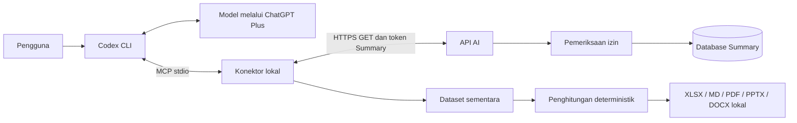
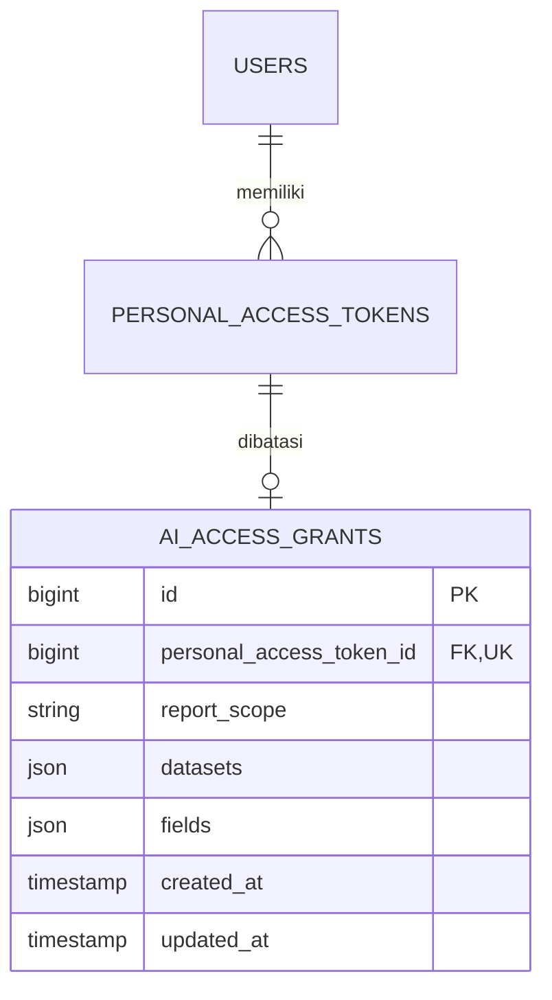
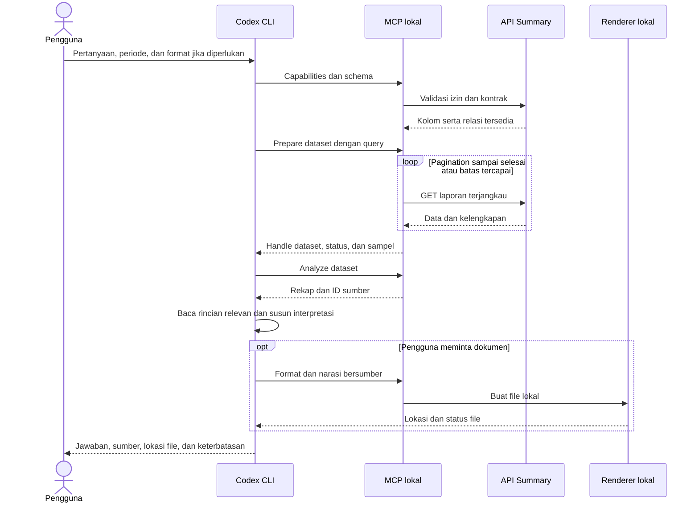

# API AI Readonly dan Dokumen Lokal

## Tujuan

Summary menyediakan data bisnis melalui API HTTPS. Codex CLI yang masuk menggunakan ChatGPT Plus membaca data melalui konektor MCP lokal, menyusun analisis, dan membuat dokumen di laptop jika diminta. What, IKU, When, dan How hanyalah contoh kolom. Seluruh kolom yang didaftarkan dalam registry dapat digunakan sesuai izin.

Summary dan konektor tidak memanggil API model, tidak memerlukan kunci OpenAI/Anthropic, dan tidak memiliki fallback berbayar. Batas penggunaan model mengikuti paket pengguna. Menjalankan CLI di laptop tidak berarti model berjalan offline.

## Komponen dan batas tanggung jawab

API hanya membaca data bisnis. Pembuatan token oleh manusia, pembaruan waktu penggunaan token, rate limit, session panel, dan audit teknis tetap dapat menulis penyimpanan teknis. Pembuatan dokumen lokal tidak menulis ke Summary.

## Autentikasi dan otorisasi

Namespace API adalah `/api/ai/v1`. API hanya menerima Bearer token Sanctum dengan abilities tepat `['ai:read']` dan grant yang sah. Token SSO wildcard dan autentikasi session saja ditolak. Token AI ditolak pada seluruh route di luar namespace AI, termasuk route web ketika terdapat session browser.

Akun harus aktif, tidak dihapus, dan secara eksplisit memiliki `use_ai_api`. Pemeriksaan permission ini tidak menggunakan bypass Gate. Izin efektif adalah irisan izin akun terkini, dataset/kolom grant, cakupan laporan, dan policy relasi. Grant tidak dapat memperluas izin akun.

`account` mengizinkan laporan sesuai policy baca akun. `own_related` menambah batas kepemilikan atau relasi pengikut. Soft delete dikecualikan. Evaluasi mengikuti policy pemilik/pengikut, administrator, atau koordinator aktif terbaru pada unit terkait; fitur Monev juga harus aktif. Dataset people memerlukan policy baca User, tetapi hanya ID dan nama orang terkait laporan yang dapat dikeluarkan.

Panel Akses AI memakai permission `use_ai_api`; tidak ada permission halaman kedua. Token awal berlaku 30 hari dengan pilihan 7/30/90 hari, cakupan `own_related`, dan kolom what/when/tanggal_selesai. Token asli hanya ditampilkan pada respons penerbitan. Pemilik dapat menutup tampilan dan mencabut token miliknya. Pergantian cakupan menggunakan token baru.

## Model grant

Satu migration aditif menambahkan grant dan permission `use_ai_api`. Token dan grant dibuat dalam transaksi. FK grant menggunakan cascade saat token dihapus. Tidak ada salinan data laporan atau tabel dokumen baru.

## Kontrak pembacaan

Registry `App\Services\Ai\Registry` adalah sumber kebenaran kolom, deskripsi, tipe, dan operator. Dataset: reports, indicators, teams, work_units, involvements, people, evaluations, documentation_metadata. Kolom baru database tidak otomatis terbuka. Password, token, email, NIP, tanda tangan, FCM token, path penyimpanan, dan konfigurasi internal tidak disediakan.

Endpoint GET/HEAD:

| Endpoint | Kegunaan |
|---|---|
| capabilities | Izin efektif, batas, expiry, dan zona waktu |
| schema | Kolom dan operator yang tersedia untuk token |
| reports | Daftar laporan terjangkau |
| reports/{id} | Detail melalui ID numerik |
| reports/{id}/followers | Pengikut dengan pagination |
| references/{dataset} | Referensi yang terkait laporan terjangkau dan lolos policy |
| evaluations | Evaluasi yang diizinkan |

Pengikut dan evaluasi bertingkat dibatasi 25 baris per laporan. `_relation_meta` menyebut total, jumlah dikembalikan, `has_more`, dan endpoint pagination. Pengambilan dataset yang memuat relasi belum lengkap ditandai parsial. Endpoint pengikut ditambahkan agar pembatasan fanout tidak menutup akses kepada data yang sebenarnya diizinkan. Untuk memfilter evaluasi berdasarkan laporan, token juga harus mengizinkan kolom `report_id`.

Query menerima fields, include, q, sort, page, per_page, serta `filter[field][operator]`. Operator eq/in/contains/gte/lte/is_null mengikuti tipe registry. Filter berbeda digabung AND; `in` menerima CSV atau array dan berarti OR. Relasi laporan dapat difilter menggunakan indicator_id/team_id/work_unit_id/involvement_id dengan operator eq jika ID relasi diizinkan. Pencarian q hanya memakai kolom teks yang diizinkan. Tidak ada SQL atau relasi bebas.

Pagination default 25, maksimum 100. Urutan selalu memiliki ID sebagai penentu tambahan. Kolom dikenal tetapi terlarang menghasilkan 403; kolom/parameter tidak dikenal menghasilkan 422. Total dihitung setelah batas akses diterapkan. Respons error mempunyai code, message, request_id. Status: 401/403/404/405/422/429/500/503.

`period_start` dan `period_end` harus diberikan bersama dengan format YYYY-MM-DD. Batas inklusif. `period_mode=overlap` adalah default; `start` memilih tanggal mulai dalam rentang. Jika tanggal selesai kosong, overlap memakai tanggal mulai. Q3 2026 berarti 2026-07-01 sampai 2026-09-30. Zona waktu mengikuti konfigurasi aplikasi, saat implementasi Asia/Jayapura.

Identitas minimum laporan adalah ID, slug, dan sumber berisi URL halaman web laporan berbasis slug serta updated_at. `source.url` mengarah ke halaman Filament `/laporan-5w1h/{slug}`, bukan endpoint API bernomor. Browser tanpa session diarahkan ke login dengan tujuan laporan disimpan sebagai intended URL; setelah login, akses mengikuti status akun, role panel, dan policy laporan. Token AI tidak digunakan pada URL dan tidak menggantikan login browser. Bila slug tidak tersedia atau tidak aman pada konektor, tautan mengarah ke daftar laporan, bukan ID numerik. ID numerik tetap dipakai internal untuk detail API, relasi dan pencocokan sumber; autentikasi serta otorisasi tetap menjadi batas keamanan, bukan kerahasiaan URL.

Konektor menormalisasi sumber pada daftar, detail, dan dataset menjadi URL web pada base URL aplikasi yang dikonfigurasi, termasuk subfolder. URL dari respons tidak dipercaya untuk mengubah domain atau membentuk path traversal. Jawaban model diarahkan menggunakan `source.url` untuk tautan, tanpa membuat tautan API sendiri. Dokumen MD memakai tautan Markdown eksplisit agar tanda baca tidak menjadi bagian alamat. Relasi dimuat hanya jika diminta. HTML diubah menjadi teks dengan paragraf dipertahankan. Null dan string angka historis tidak diisi atau diperbaiki diam-diam. Metadata lampiran hanya menyebut jenis yang tersedia; isi dan lokasi tidak diberikan.

## Konektor dan penghitungan

Konektor memakai Node.js 22.13+, TypeScript, SDK MCP v1, HTTPS, sertifikat sah, dan stdio. Endpoint/domain dipetakan eksplisit; redirect ditolak. Timeout 30 detik, dua permintaan bersamaan, paling banyak dua retry gangguan jaringan/429/5xx. Retry-After lebih dari 30 detik dikembalikan sebagai instruksi menunggu, bukan tidur panjang. Rahasia tidak dikeluarkan melalui tool atau log.

Tools: summary_capabilities, summary_schema, summary_list_reports, summary_get_report, summary_list_references, summary_list_evaluations, summary_list_followers, summary_prepare_dataset, summary_analyze_dataset, summary_create_documents.

Dataset hanya disimpan dalam memori. Batas awal 5.000 laporan, total ukuran data terserialisasi 50 MiB, empat handle, dan kedaluwarsa 30 menit setelah tidak digunakan. Penggunaan heap proses dapat lebih besar daripada ukuran serialisasi. Pengambilan berlebih, perubahan total/duplikasi saat pagination, atau relasi terpotong ditandai parsial. Tidak ada jaminan snapshot lintas permintaan. Sampel hanya contoh dan bukan seluruh data untuk kesimpulan naratif.

Hanya satu persiapan dataset dapat berjalan; permintaan persiapan lain ditolak dengan instruksi mencoba kembali, tanpa antrean. Koleksi berjalan mereservasi ukuran data dengan mengeluarkan cache lama sebelum menambah baris. Metadata field mencatat proyeksi yang benar-benar diambil dan relasi include, bukan seluruh kolom yang tersedia pada schema. Kolom peserta yang tidak diambil tidak menghasilkan jumlah nol atau hitungan kosong palsu.

Kode lokal menghitung ID unik, kelompok, jumlah kehadiran sah, nilai tidak valid, dan nilai kosong. Kehadiran bukan orang unik. Kelompok relasi dapat tumpang tindih; total keseluruhan bukan penjumlahan kelompok. Tanggal tidak sah tidak menghasilkan triwulan buatan. Tidak ada klaim pencapaian IKU tanpa target serta metode pengukuran.

## Dokumen

Tanpa permintaan format, Codex menjawab di terminal. Jika diminta, beberapa format dapat dibuat sekaligus. Renderer menerima dataset, groupBy, judul, format, dan bagian naratif dengan ID sumber. Sumber narasi yang tidak terdapat dalam dataset ditolak.

XLSX memakai ExcelJS, DOCX memakai docx, PPTX memakai PptxGenJS, PDF memakai PDFKit dengan font DejaVu berlisensi, dan Markdown memakai teks UTF-8. Tidak memerlukan layanan konversi, Microsoft Office, atau LibreOffice pada laptop pengguna.

Workbook berisi Rekap, Data Kegiatan, Relasi IKU, Sumber, Keterangan. Data kegiatan satu baris per laporan; relasi banyak IKU disimpan terpisah. Nilai sumber adalah literal, bukan formula. Teks melampaui kapasitas sel dibagi menjadi kolom lanjutan.

PDF dan Word menggunakan A4. Presentasi memakai 16:9 dan membagi isi panjang menjadi slide lanjutan. Sumber lengkap presentasi tersedia pada catatan pembicara. Angka rekap sama pada semua format; narasi dinyatakan sebagai interpretasi AI.

File memuat waktu pengambilan, query/periode, aturan pengelompokan, sumber, dan penanda parsial. Folder keluaran default `~/Summary-outputs`. Nama disanitasi dan diberi waktu serta akhiran unik. Penulisan menggunakan staging dan rename; kegagalan tidak meninggalkan hasil seolah sukses. Symlink dan path keluar folder ditolak. Dataset mentah tidak disimpan terpisah kecuali pengguna meminta.

## Alur kerja

## Verifikasi dan operasional

Pengujian PHP menggunakan SQLite in-memory sesuai phpunit.xml. Smoke test membuat database SQLite baru pada folder fixture yang diabaikan git, bukan database aplikasi. Smoke menguji MCP stdio, HTTPS dengan CA lokal, kernel Laravel asli, periode, angka, dan lima format. Browser serta render Office dipakai hanya untuk verifikasi pengembangan, bukan dependensi runtime.

API default nonaktif. Rate limit 60/menit/token dan 120/menit/pengguna. Respons private/no-store. Audit harian 14 hari berisi identitas teknis, status, durasi, dan jumlah hasil tanpa token atau isi laporan. Deployment dan rollback mengikuti panduan terpisah.
